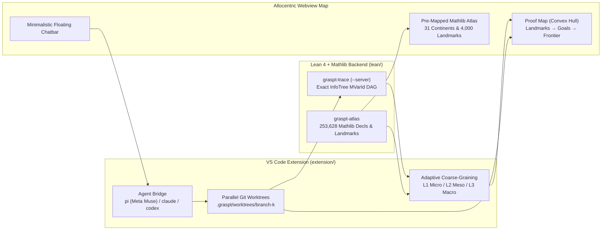

# Graspt

**Allocentric Topological Proof Navigation for Lean 4 + Mathlib, powered by AI Coding Agents (`pi` + Meta Muse).**

> *"A geometric and topological metaphor for the space of what humanity already knows, and what can be reached just by combining existing ideas."*

---

## Why Graspt?

Interactive theorem proving in **Lean 4** is traditionally **egocentric**: you stare at a local text buffer and a sequential tactic log (`intro`, `rw`, `simp`, `exact`), trying to hold an invisible, high-dimensional dependency graph in working memory while an LLM streams tokens into a chat sidebar.

**Graspt** flips this paradigm by separating **allocentric global navigation** (what humans excel at perceptually) from **egocentric symbolic execution** (what **Lean 4** and AI coding agents like **`pi`** running **Meta's Muse** models excel at):

1. **Filling in the Convex Hull of Knowledge:** Every theorem you want to prove lives inside—or on the frontier of—the convex hull spanned by known **Landmarks** (definitions, lemmas, and hypotheses in **Mathlib**).
2. **Allocentric Navigation is Computationally Universal:** Grounded in Gualtiero Piccinini's [*Allocentric Navigation is Computationally Universal* (arXiv:2603.27926)](https://arxiv.org/abs/2603.27926) and Generalized SLAM ([Safron et al., 2022](https://doi.org/10.3389/fnsys.2022.787659)), Graspt treats theorem proving as navigating a **topological map of landmarks and intermediate goals**.
3. **Adaptive Coarse-Graining (`L1` / `L2` / `L3`):** What looks like a 15-line tactic grind to a beginner is a single obvious bridge to an expert. Graspt lets you dynamically zoom the proof graph between **L1 (Micro — every tactic step)**, **L2 (Meso — branching & landmark bridges)**, and **L3 (Macro — only Landmarks + Open Frontiers)**, with one-click **Unpack (`🔍`)** and **Chunk (`📦`)**.
4. **Parallel Lookahead via `git worktree` + `pi` (Meta Muse):** Instead of mutating your active editor buffer while guessing tactics, Graspt dispatches **`pi` (`pi.dev`)** (configured with **Meta's Muse** models such as `meta/muse-spark-1.3` and `meta/muse-wonder-1.0`) and verifies candidate tactic branches in isolated `.graspt/worktrees/branch-k` sandboxes backed by a persistent `graspt-trace --server` pool. Only Lean-verified branches light up green for one-click splicing.

---

## Architecture



---

## Repository Layout

| Path | Description |
| :--- | :--- |
| [`lean/`](./lean) | Lake project (`leanprover/lean4:v4.36.0-rc2`) with pre-cached **Mathlib** |
| [`lean/Graspt/Trace.lean`](./lean/Graspt/Trace.lean) | Core Lean 4 `InfoTree` elaborator extracting exact `MVarId` goal nodes, tactic edges, and referenced Mathlib constants |
| [`lean/Graspt/TraceMain.lean`](./lean/Graspt/TraceMain.lean) | `graspt-trace` CLI executable (single-shot JSON & persistent `--server` mode with in-memory header caching) |
| [`lean/Graspt/AtlasMain.lean`](./lean/Graspt/AtlasMain.lean) | `graspt-atlas` CLI executable that indexes **253,628 Mathlib declarations** across **31 areas** and ranks the top **4,000 Landmarks** |
| [`lean/Demo/LocalLayout.lean`](./lean/Demo/LocalLayout.lean) | Formalization of Piccinini's **2D Local-Layout Allocentric Navigation Machine** ([arXiv:2603.27926 §6](https://arxiv.org/abs/2603.27926), Lemma 6.3 `stepSucc_ρ` proved + 4-branch `stepPred_ρ` open frontier) |
| [`lean/Demo/Basics.lean`](./lean/Demo/Basics.lean) | Cross-Mathlib showcase theorems across Topology (`compact_image_closed`), Algebra (`even_add_even`), and Number Theory (`two_dvd_mul_succ`) |
| [`extension/`](./extension) | **Graspt** VS Code Extension (`graspt.graspt`) |
| [`extension/src/model.ts`](./extension/src/model.ts) | Multi-resolution topological proof map builder (`L1`/`L2`/`L3` coarse-graining, `Unpack`, `Chunk`, and Mathlib landmark linking) |
| [`extension/src/worktree.ts`](./extension/src/worktree.ts) | Zero-copy parallel candidate verifier using `git worktree` (with symlinked `.lake` build caches) + `TracePool` |
| [`extension/src/agent.ts`](./extension/src/agent.ts) | CLI Agent bridge for **`pi` (`pi.dev`)** with **Meta Muse** (`meta/muse-spark-1.3`, `meta/muse-wonder-1.0`), `claude`, `codex`, and `opencode` |
| [`extension/src/doctor.ts`](./extension/src/doctor.ts) | Dependency Doctor verifying `leanprover.lean4`, `elan`/`lake`, Mathlib `.olean` cache, `graspt-trace`, `atlas.json`, `META_API_KEY`, `pi`, and `git worktree` |
| [`extension/webview/main.ts`](./extension/webview/main.ts) | Cytoscape + Dagre topological map renderer, Convex-Hull landmark combiner, and Minimalistic Floating Agent Chatbar |

---

## Quickstart

### Local Build

Run the steps manually:

#### 1. Build the Lean 4 Tracer & Mathlib Atlas

```bash
cd lean
lake exe cache get
lake build graspt-trace graspt-atlas Demo

# Generate the pre-mapped Mathlib Atlas (.graspt/atlas/atlas.json & importance.json)
lake exe graspt-atlas
```

Test tracing a Lean file directly from the CLI:

```bash
cd lean
lake exe graspt-trace Demo/LocalLayout.lean
```

#### 2. Build & Install the VS Code Extension

```bash
cd extension
npm ci
npm run typecheck
npm run build
```

---

### 3. Configure Meta Muse in `pi` & Launch the Map

1. Open [`lean/Demo/LocalLayout.lean`](./lean/Demo/LocalLayout.lean) or [`lean/Demo/Basics.lean`](./lean/Demo/Basics.lean) in VS Code.
2. Run **`Graspt: Open Proof Map`** from the Command Palette (`Ctrl+Shift+P` / `Cmd+Shift+P`) or click **`$(compass) Graspt`** in the status bar.
3. Click **`🔑 Meta Muse Key`** in the top bar (or run **`Graspt: Set Meta AI (Muse) API Key for pi`**) to save your `META_API_KEY` and select **`meta/muse-spark-1.3`** or **`meta/muse-wonder-1.0`**.
4. **Navigate & Prove:**
   - Switch between **`L1 Micro`**, **`L2 Meso`**, and **`L3 Macro`** to adjust proof fidelity.
   - **Shift-click** multiple purple **Landmark** nodes to combine them into a convex-hull prompt.
   - Click any amber **Frontier (`sorry`)** node and dispatch **`pi`** from the floating chatbar—Graspt will test candidate tactics in parallel `git worktree` sandboxes and let you **`✓ Splice into Lean file`** with one click.

---

## References

- Gualtiero Piccinini (2026), *"Allocentric Navigation is Computationally Universal"*, [arXiv:2603.27926](https://arxiv.org/abs/2603.27926).
- Adam Safron, Ozan Çatal, & Tim Verbelen (2022), *"Generalized Simultaneous Localization and Mapping (G-SLAM) as unification framework for natural and artificial intelligences"*, *Frontiers in Systems Neuroscience*, [doi:10.3389/fnsys.2022.787659](https://doi.org/10.3389/fnsys.2022.787659).
